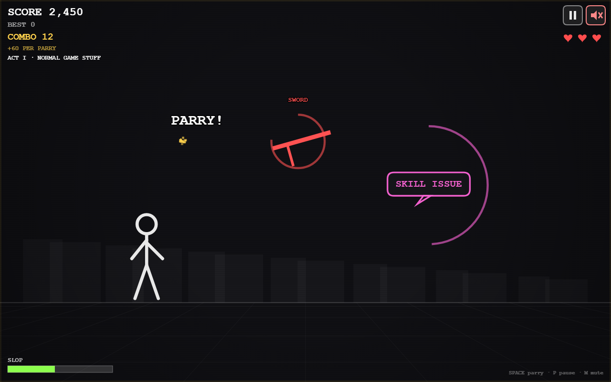

# Parry Slop

**One button. No restraint.** Parry swords, arrows, bullets, fireballs — then insults,
pop-up ads, tax audits, falling pianos, the health bar, and eventually the parry
button itself.

> **If it exists, you can parry it.**



## Play

**Live:** <https://demerest.github.io/parry-slop/>

Or open `index.html` in any browser. No build step, no dependencies, no external
assets. Works from `file://` and from static hosting.

## Controls

| Input | Action |
|---|---|
| Click / tap | Parry |
| Space / Enter | Parry |
| P / Esc | Pause |
| M | Mute |
| S (title) | PAR ASSIST settings |

That is the entire game. Menus use the same single button.

## How it works

An attack telegraphs from the right. A timing ring closes around it. Press when
the ring closes — at the moment of impact.

| Result | Meaning |
|---|---|
| Perfect parry | Inner 35% of the window: bonus score, flash, micro-freeze |
| Normal parry | Inside the window: score + combo |
| Too early / whiff | Combo reset + short input lockout (mashing loses) |
| Miss | -1 HP, combo reset. 3 HP per run |
| Dashed grey ring | Fake attack. Do **not** parry. Let it pass for a RESTRAINT bonus |

Score = 100 base + 5 per combo level + 150 perfect + 250 weird. Best score,
settings, and lifetime parries persist in `localStorage` (safely ignored when
unavailable).

### The Slop Meter

Parrying nonsense fills the Slop Meter; it drains over time. Max it out and
**SLOP OVERFLOW** triggers: eight seconds of glitched background where every
parry counts as weird.

### Progression

Endless arcade run in four acts, each unlocking stranger attack categories:

```text
ACT I   NORMAL GAME STUFF          swords, arrows, bullets, fireballs, insults
ACT II  WHY IS THERE A TAX AUDIT?  absurd physics, responsibilities, fakes
ACT III THE INTERFACE IS HOSTILE   internet junk, concepts, meta UI, chains
ACT IV  PARRY GOD                  everything, tighter timing, fakeouts
```

Boss events arrive on a fixed interval: **THE ALGORITHM**, **SIR PARRYALOT**,
**THE UI**, and **THE PARRY BUTTON**. Each is a scripted parry chain with a boss
HP bar; clear it for +1500. Ignore it and it escapes, remembering everything.

Attack behaviors include standard, delayed (holds, then lunges), lobbed,
wobble, homing, multi-hit (re-arming rings), and fake. Rhythm chains and rare
specials (MONDAY, the word PARRY) keep runs varied. Impacts are always spaced
farther apart than the input cooldown, so no chain is physically unparryable.

### Secrets

- Parry the title logo.
- Parry the game over screen.
- 100 parries in one run rolls fake credits.
- 500 lifetime parries earns a title-screen badge.
- Max the Slop Meter.

## Accessibility — PAR ASSIST

Settings (gear on title, or `S`): **Big Parry Window** (1.5x), **Reduced Shake**,
**High Contrast**, **Flash Safe** (no full-screen flashes), **Audio Cues** (tick
when the window opens). All persist. Attacks are labeled and shaped, never
color-only. Sound is procedural WebAudio, on by default, mutable from the
top-right button or `M`, and only starts after a user gesture.

The game auto-pauses when the tab is hidden or the window loses focus; the
play-clock freezes, so returning never costs you HP.

## Project structure

```text
parry-slop/
  index.html          shell, meta, favicon, script load order
  src/
    core.js           constants, RNG (seedable), math, safe storage
    audio.js          procedural WebAudio sound manager + mute
    attacks.js        51 data-driven attacks, text pools, acts, patterns, bosses
    game.js           play-clock simulation, parry resolution, director, state
    render.js         canvas renderer: world, stickman, HUD, screens, effects
    main.js           boot, input, resize, visibility pause, loop, test hooks
  tests/
    harness.html      headless-Chrome assertion harness (synthetic clock)
    run.js            32 gameplay assertions
    shot.html         staged scene driver for screenshots
    run-tests.ps1     runs harness + screenshots via headless Chrome
  docs/
    game-design-document.md
    implementation-phases.md
    review-notes.md   design review, amendments, verification limits
    screenshot.png
```

Plain scripts sharing one `PS` namespace (no ES modules) so `file://` keeps
working. Gameplay runs on an accumulated play-clock; rendering uses real time.
Update and draw are fully separated, which is what makes the game testable
headlessly.

## Tests

No Node required — headless Chrome is the runtime:

```powershell
powershell -NoProfile -ExecutionPolicy Bypass -File tests\run-tests.ps1 -Shots
```

32 assertions: timing windows, perfect/normal/whiff/miss outcomes, cooldown and
whiff lockout, death/restart delay, persistence, pause/resume, difficulty
scaling, seeded determinism, acts, rhythm chains, delayed holds, multi-hit
re-arms, fake attacks, boss defeat/escape, slop overflow, fake credits, resize,
restart stability, and a frame-budget smoke test. Screenshots land in
`%TEMP%\ps-test\`.

Verified in headless Chrome at desktop and narrow viewports. Real-device
Safari/Firefox/Android passes are still open (see `docs/review-notes.md`).

## Adding attacks

Everything is data. Append to `PS.ATTACKS` in `src/attacks.js`:

```js
{
  id: "invoice", kind: "card", label: "INVOICE", color: "#a3ff6b",
  category: "responsibility", telegraph: 1250, window: 230,
  weight: 1, weird: true, minAct: 3,
  parryPool: ["NET 30? NET NEVER.", "PAID IN PARRIES"]
}
```

Kinds: `blade`, `arrow`, `bullet`, `orb`, `spin`, `crate`, `bubble`, `card`,
`widget`, `word`, `critter`. Behaviors: `standard`, `delayed`, `lobbed`,
`wobble`, `homing`, `fake`. Optional `hits` + `hitGap` for multi-hit, `rare`
for low-probability specials, `labelPool`/`parryPool`/`missPool` for jokes.

Good attacks are readable, funny when parried, and deadpan. Bad attacks hide
their timing or need a second button.

## Design docs

- `docs/game-design-document.md` — the full design bible
- `docs/implementation-phases.md` — phase plan with live completion status
- `docs/review-notes.md` — review findings, amendments, verification limits

## License

MIT — see `LICENSE`. Parry it freely.
